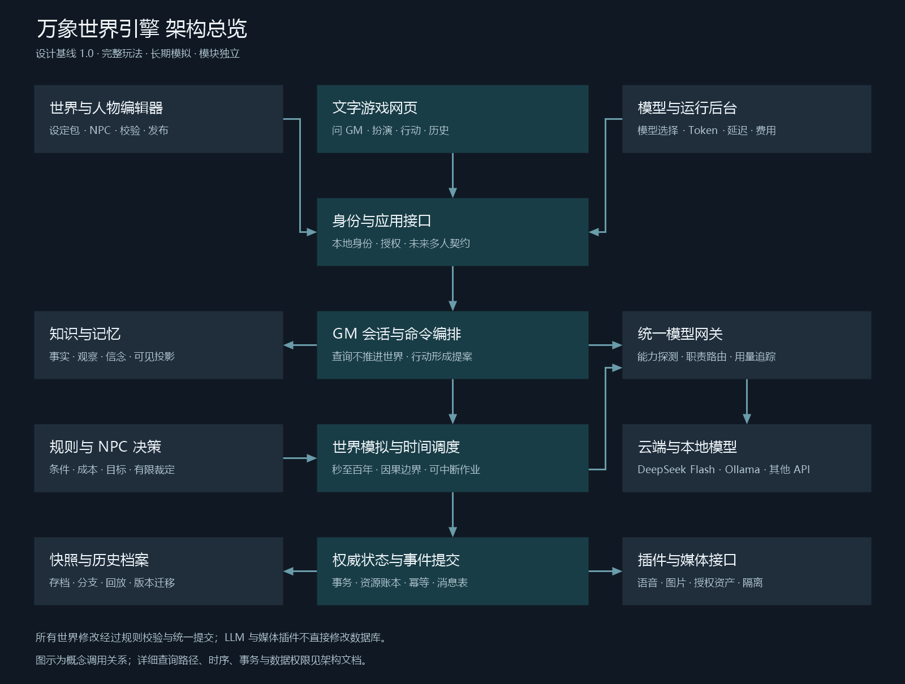
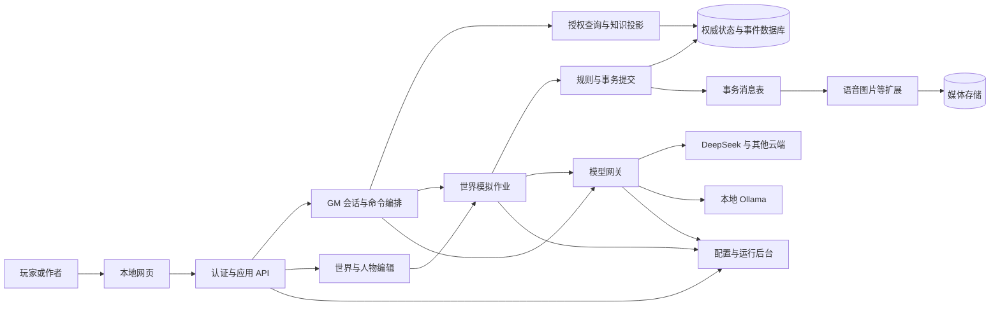
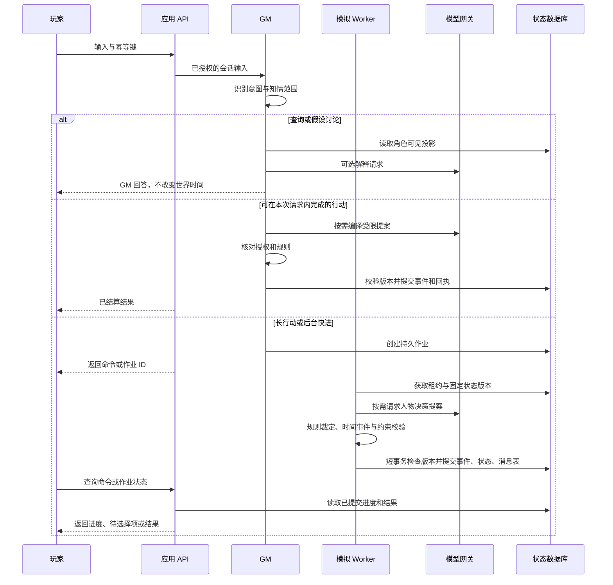
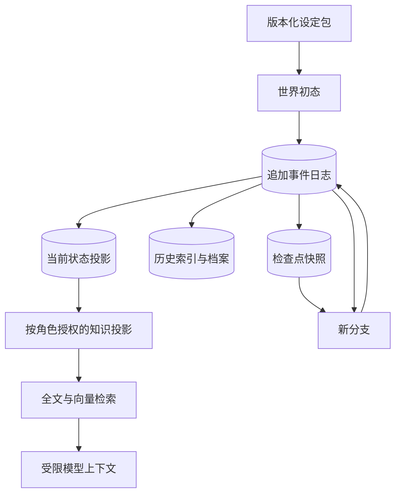
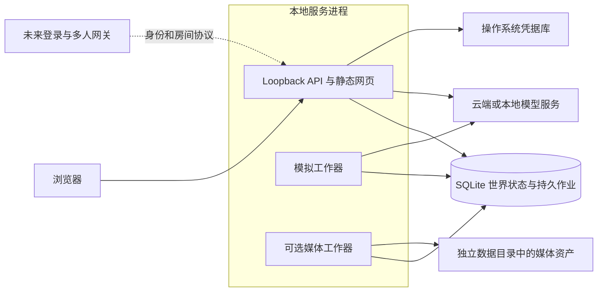

# 世界引擎架构设计

本地版采用模块化单体。一个 Uvicorn 进程提供网页和 API，并在应用生命周期内启动模拟工作器。启用媒体插件时，同一进程另启动媒体工作器。工作器依赖数据库里的持久作业、租约和检查点恢复。事务数据库保存权威世界状态，模型输出先作为提案校验，叙述可根据已提交结果重新生成。

[可编辑 SVG 总览](diagrams/architecture-overview.svg)展示模块边界。下文的 Mermaid 图展示系统上下文、行动时序、数据与本机部署。

## 技术选型

本地运行依赖由 `requirements.lock.txt` 和 `frontend/package-lock.json` 锁定。[运行环境与安装说明](development/runtime.md)

| 层 | 选择 | 原因与限制 |
| --- | --- | --- |
| 网页 | TypeScript、React、Vite | 类型化表单与复杂状态界面；静态构建可由本地服务提供 |
| API 与领域 | Python、FastAPI、Pydantic | 清晰的输入契约，便于模拟与模型适配；领域规则不依赖 HTTP 框架 |
| 数据访问 | SQLAlchemy、Alembic | 统一迁移管理；SQLite 与 PostgreSQL 差异通过适配与双数据库测试处理 |
| 本地数据 | SQLite WAL、单世界提交队列 | 本地部署简单；避免长事务和把网络调用放进数据库锁内 |
| 后续服务数据 | PostgreSQL 存储适配 | 多用户多进程的锁与事务实现需要实际验证，非换 URL 即完成 |
| 作业 | 数据库持久作业与应用内工作器 | 通过租约、重试、取消和检查点恢复 |
| 搜索记忆 | 结构化过滤、全文检索、可选向量索引 | 向量库非真相库；授权过滤先于召回及重排 |
| 进度 | HTTP 命令与状态查询 | 活跃命令与长动作默认每 1.5 秒查询一次，断线后可凭命令或作业 ID 读取已提交状态 |
| 观测 | 结构化日志、Trace、指标接口 | 模型调用和世界变更共享关联 ID，默认不记录敏感正文 |
| 媒体 | 本地文件对象存储接口 | 内容寻址与权限校验；未来适配对象存储 |
| 凭据 | 操作系统凭据库或进程环境 | 数据库存引用；本地启动时生成会话认证，不开放裸控制接口 |

采用 SQLite 的目的是本地可安装性。未来多人接口需要从第一天携带租户和世界范围，并用 PostgreSQL 契约测试防止隐式 SQLite 假设。首版不直接运行复杂集群。

## 系统上下文图

## 模块责任与接口

| 模块 | 拥有的数据与职责 | 对外接口 | 禁止事项 |
| --- | --- | --- | --- |
| Identity | 用户、凭据引用、世界成员、角色控制租约 | authorize、resolve_actor | 直接改世界物资 |
| Authoring | 设定草案、模板、校验、发布版本、迁移提案 | validate_pack、publish_pack | 覆盖已有历史 |
| Conversation | GM 会话、消息类型、意图分段、澄清 | classify、answer、submit_intent | 查询自动创建行动 |
| Knowledge | 事实引用、观察、信念、言论、记忆和索引 | observe、retrieve、project | 将全知知识送入角色上下文 |
| Simulation | 时间、任务、调度、精度、计划与中断 | advance、schedule、pause | 直接写叙述充当历史 |
| Rules | 动作规格、前置条件、成本、结果、约束 | propose、validate、resolve | 执行模型任意代码 |
| WorldState | 当前实体、关系、资源账、事件和版本 | commit、snapshot、replay | 接受未验证的任意 JSON patch |
| Agents | 人物目标、计划、反思和选择 | plan、react、reconsider | 私自提交最终状态 |
| SocialEconomy | 生产、物流、组织、政治、人口 | tick、evaluate_threshold | 与世界时钟独立结算同一周期 |
| Narrative | 基于已批准语义的文本及事实引用 | narrate、rewrite | 创造未登记的可交互实体 |
| ModelGateway | 供应商、模型能力、路由、用量和追踪 | generate、embed、probe | 访问完整数据库或返回凭据 |
| Extensions | 插件清单、权限、订阅、媒体作业 | dispatch_event、submit_asset | 绕过命令总线写数据库 |
| Operations | 作业、审计、备份、诊断与升级状态 | monitor、cancel、restore | 把估算费用标成已结算账单 |

领域模块之间通过声明的接口和事件协作，不能跨模块读取内部表。共同类型只包含 ID、时间、金额、错误、事件信封和授权上下文，避免共享层吸收全部业务。

网页位于 `frontend/src`。后端入口是 `backend/world_engine/runtime.py`，其同级目录 `api`、`application`、`domain`、`rules`、`agents`、`simulation`、`storage`、`adapters` 和 `content` 分别承载 HTTP 协议、应用编排、领域类型、规则、人物决策、排程、存储、外部适配与背景内容。扩展契约通过宿主接口连接，媒体插件实现位于 `adapters/media`。

## 一次行动的时序图

世界事务不跨越网络调用。worker 读取快照后生成提案，提交时检查版本；版本过期时丢弃或重新验证提案，不能套用到新状态。网络重试可能重复产生模型账单，但幂等提交确保同一业务变化最多应用一次。

行程自动自理经原生规则结算时，工作器可以随这一次提交携带已经验证的终态。仓库在有效租约内核对原状态、指令和完整有序事件，再核对终态的有序表示及摘要。仅包含一个行程延迟且无需追加事件的原批次可复用该终态。仓库仍逐项写入事件时点、账本与通知，常规归约负责需要追加事件或凭证校验失败的批次。凭证只在这一次进程内调用有效，恢复和回放以已提交事件为准。

世界内对话的语义先作为事件提案处理，包括说出的主张、承诺、情报和受众；通过校验再提交。最终润色不得添加新的承诺、交易和秘密。普通场景叙述在事实提交后生成。这样既不允许叙述倒灌事实，也不丢失对白本身的世界影响。

## 持久作业与事务

每个 world_id 和 branch_id 同时只有一个持有有效写入 fencing_token 的调度者。租约过期后的旧 worker 即使恢复也不能提交。独立模型计算可并发，但结果需在统一提交器中排序、校验。

事务内一次写入事件批次、资源账、当前状态、待处理事件变更、命令结果和 outbox。outbox 至少一次投递，消费者按 event_id 和处理器版本去重。外部媒体失败不回滚已经发生的世界事件。

取消在检查点生效。长动作由多个已提交的时间片组成，取消只停止未来时间片。普通原子交易不允许取消一半。作业状态包括 queued、running、waiting_input、paused、succeeded、failed、cancelled；世界已部分推进的失败标记 committed_through_tick，界面准确展示。

## 数据架构图

事件包含稳定的领域结果，回放只执行确定性 reducer，不重做 LLM 决策或随机抽样。快照包含事件序号、状态哈希、规则版本、计划队列和随机流状态。源事件不被摘要替代；冷历史可以压缩分区，但按人物、时期和因果链仍可查询。

分支读取父分支直到 fork_seq 的历史前缀，再接自己的事件后缀。父分支后来的知识和嵌入不能进入子分支。初版分支不支持自动合并两段互相矛盾的历史；迁移和作者修正用新事件或新分支明确处理。

## 本地部署与未来多人

本地默认仅监听 loopback，允许的 Origin 与 Host 固定，本地会话令牌避免其他网页调用控制接口。未来服务部署增加认证适配器、TLS、租户存储配额和房间协调，不能仅把监听地址改为公网。

多人协议预留 room_id、member_id、actor_id、world_version、时间屏障和角色控制租约。同一时间窗口多个行动基于同一快照提出，冲突由规则处理；提案窗口超时按房间规则等待、弃权或继续，不能由网络请求到达顺序决定谁先偷走物品。默认世界暂停于无活跃玩家，离线运行策略由主持者明确设置。

`RoomCoordinator` 提供可执行的协调契约，复用仓库的成员与角色授权。主持端提供可信时钟和已验证的分支版本，将房间状态转换串行化。时间屏障关闭后交给规则引擎判定；正式接入需要持久保存协调回执，并在原生分支写入租约和版本校验下提交结算。本地单人服务继续使用单人会话入口。

两个隔离玩家在同一分支版本竞争最后一件商品。交换两个提案的到达顺序后，正式市场规则给出相同结果。契约测试同时覆盖过期或撤销的控制权、跨房间请求、等待或弃权，以及默认离线暂停。

## 插件接口与隔离

插件声明 id、版本、支持的引擎版本、订阅事件、需要的权限、输入输出 schema、资源限制与配置 schema。规则插件、模型适配器、检索插件、媒体插件分别注册，不允许任意插件拦截所有数据库调用。

语音插件接收 narration.finalized 的文本与声线参数；图片插件接收经授权的场景描述与资产引用。输出绑定 source_event_id、branch_id、visibility_scope 和 content_hash。重绘不改变人物外貌真相；旁白配音不能成为新的 NPC 言论。

第三方进程默认通过 IPC 或 HTTP 的受限宿主接口运行。Python 进程本身不是安全沙箱；不可信代码需要 OS 级隔离，未提供隔离时只允许明确安装的可信插件。导入世界包不会自动安装或执行插件，缺少模块时提供可读兼容报告。

## 故障处理

| 故障 | 行为 |
| --- | --- |
| 模型不可用 | 保留命令，规则可独立完成则继续，否则暂停；不伪造智能结果 |
| 叙述失败 | 显示已提交的简明结果，稍后重新生成表达 |
| 提交前崩溃 | 状态无变化，作业重新获取租约并恢复 |
| 提交后断线 | 查询同一命令得到原结果，不重复执行 |
| 磁盘不足 | 暂停新提交，展示恢复步骤；保留已有可用快照 |
| 归档或备份失败 | 不删除源数据，报告失败并允许重试 |
| 规则升级不兼容 | 保持旧版本运行，迁移到副本并验证再切换 |

## 架构决策记录

采用混合确定性模拟和受限 LLM 决策，不把整个世界交给单一提示词。采用声明式规则和类型化事件，避免自由文本补丁损坏账本。采用本地模块化单体，后续按真实性能瓶颈拆分服务。采用历史事实与人物认知分离，支持误解、谎言和不同视角。

每项未来改动要记录涉及的 R 编号、接口版本、迁移方式、旧存档兼容性与验证证据。不能以模块化为名引入未经定义的循环依赖。
