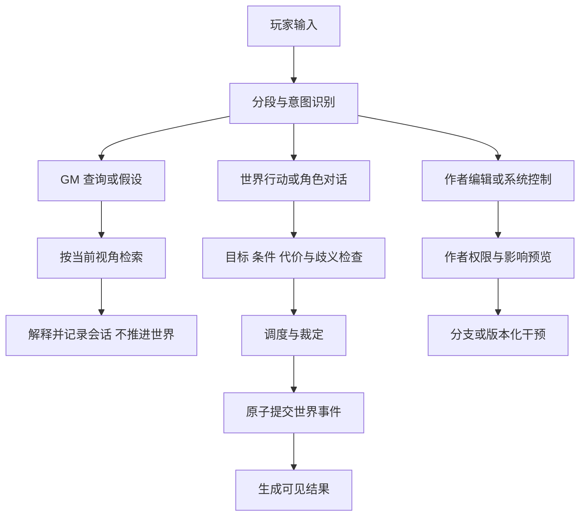

# GM 与长期世界模拟

模拟以统一世界时钟、类型化事件和可恢复检查点运行。模型提供解释与决策提案，领域规则完成有约束的状态变化。宏观计算可以聚合，但不能凭结尾叙述推定过去发生了什么。

## GM 的两条处理路径

查询对话进入单独会话历史，不能混入 NPC 的亲历记忆。GM 提供一般设定解释时，只使用当前模式允许的世界知识。玩家问谁是凶手时，玩家模式只整理已知证据；作者模式才可读取已确定真相。未生成的真相要标记未定义，不能为回答查询临时确定一名凶手。

假设讨论使用条件语言；若用户要求实际推演，创建隔离分支并标注与真实存档不同。询问如果闭关十年会怎样，不等于提交十年闭关。

行动的文本分析给出语义、目标、时间意图、约束、条件、停止点和不可逆程度。低风险明确行动直接执行；歧义只在会改变目标或后果时澄清。作者修改不借用 GM 行动权限绕过规则。

## 行动和对话裁定

规则优先级依次为世界硬约束、已存在事实、动作模块规则、已生效的局部裁定、受限临时裁定、叙事表达。来源互相矛盾时先停在需要澄清或规则拒绝，不让模型自己选择更戏剧性的版本。

确定性结果直接计算。概率结果依据规则的概率模型、难度与能力产生，记录抽样值和规则版本。社会判断结合人物目标、记忆、信息、利益、风险和底线，由模型提出候选；程序检查可用资源、权力范围和行动可达性。

例如贿赂守卫：先确定玩家提出了什么，守卫是否听见，钱是否只是展示还是转移；守卫基于其处境决定接受、拒绝、拖延或告发。资源转移与后续开门分别是有条件事件。说服成功不自动意味着守卫拥有开门权限。

临时裁定遵循四步：寻找已有规则类比 → 限制影响范围及数值 → 验证前置条件和守恒 → 记录规则签名与理由。相同条件下复用先例，避免每轮任意变化。任何需要新能力体系、无限资源或永久制度改变的请求转为作者规则编辑；人物通过合法政治程序改变制度则按组织模块执行。

对白先生成语义草案和受众，其中的承诺、消息、威胁、报价可作为事件。校验后生成最终措辞；如果润色引入新实质信息则重新校验，不允许先展示未经提交的承诺。氛围描述中出现可利用物件时，必须通过受限内容生成模块登记或移除。

## NPC 决策

人物不是每轮重生的提示词。它持有当前需求、身份职责、目标树、计划、关系、知识与稳定价值观。

候选动作来自可行行动集合，包括维持生活、履行义务、推进目标、应对危险和社交。先过滤不可行项，再按紧迫性、价值观相容性、收益、风险、关系义务和惯性排序。普通日程用规则策略，冲突或重要决策调用 LLM。模型输出选项、简短决定依据与引用事件，不依赖输出隐藏思维过程。

计划带失败条件、重试退避和替代路径。例如商店关门后可以稍后再去、换店或取消，不连续数百次执行同一个失败动作。目标成功、失效、放弃或被新目标替代都有记录。

重规划触发包括：资源不足、重大新消息、计划冲突、伤病、亲密关系变化、组织命令、目标期限、环境变化。反思发生于显著经历或计划周期，不每分钟总结整个人生。长期反思只形成新的信念与偏好提案，不能改写经历。

关键人物保留完整身份、计划和重要记忆；普通具名人物使用低成本策略并在相关事件中提升精度。人物是否重要不等于是否永生。

## 信息传播

消息由发送者、渠道、接收者、内容主张、出发 tick、到达条件、可信度和失真规则组成。书信需要运输，电话需要网络，传音需要能力和距离。事实发生与人物获知可以相隔多年。

目击依据同地、感知、注意和遮挡判定；远处 NPC 不从全局事件日志自动学习事实。传闻在传播时可丢失细节或被人物修改，保留来源链。重复来源不应被当作多条独立证据累积绝对可信度。

人物收到证据后更新信念，允许犹豫、否认和偏见，但不能凭空获取证据之外的信息。系统级权限防止直接泄露数据，模型仍可能猜中秘密；产品验收区分无依据推测、错误地声称知情和真实信息泄漏，并使用有对照的隐藏信息测试。

## 时间模型

最小时间单位固定为设定秒，支持低于一秒的玩法时通过更细 tick 配置创建新世界版本；运行中不更改基本单位。动作有开始、进行和完成事件。对白可以在同一逻辑 tick 排序，长操作必须给出合理持续时间。

调度队列按 due_tick、phase、priority、stable_event_id 排序。到同一时间边界时，先处理已到达的环境和传递事件，再构建决策快照，收集并发意图，解析冲突，提交动作结果，最后产生观察。具体死亡、伤害等冲突由动作规则定义，不能依赖数据库插入顺序决定。

一个时间窗口内的资源冲突统一解析：两人同时购买一件物品，依据预定交易或竞争规则选择结果，不能让较快返回的模型获胜。独立角色可以并发规划，提交仍保持权威顺序。

## 分层模拟

| 层次 | 保留状态 | 推进方式 | 提升精度条件 |
| --- | --- | --- | --- |
| 场景 | 感知、站位、对话、冲突、物品 | 秒到分钟，按动作边界 | 玩家在场或激烈互动 |
| 人物 | 日程、任务、健康、关系与知识 | 计划到期或事件唤醒 | 目标冲突、重大经历 |
| 地区 | 生产、库存、运输、人口、治安 | 小时到季节，自适应分段 | 灾害、战争、供应链阈值 |
| 国家组织 | 制度、财政、派系、外交、继承 | 决策到期、阈值和周期 | 政变、战争、领导更替 |
| 历史 | 世代、技术、组织兴衰和档案 | 多个已验证周期的聚合 | 关键人物或世界级影响 |

不以固定距离作为唯一精度标准。玩家远方的亲属、债务、宿敌和承诺即使遥远，也必须在到期和关联事件发生时处理。纯粹未被观察且没有重要约束的背景细节可延迟生成；一旦成为事实，后续不能重抽。

聚合记录包含 interval_start、interval_end、初始摘要、输入输出账、采用的规则、误差界限、重要事件和来源分区。不得声称聚合期间每个居民的日常对话都已模拟。降精度仅压缩无关细节，具名人物的生命状态与义务不被压缩掉。

## 长期快进算法

1. 将玩家长期行为编译成目标、资源预算、例行安排、授权范围和停止条件。
2. 确认世界时钟、状态版本、规则锁和当前队列，保存检查点。
3. 计算下一个边界：已排事件、资源耗尽、寿命与健康阈值、成长突破、组织决策、外部危险、用户指定日期中的最早者。
4. 对边界之前可安全聚合的过程按公式或分段求解，生成生产消费及人口等事件；不能越过已知断粮、付款或突破边界。
5. 在边界触发相关人物与组织决策，处理冲突和消息传播。
6. 验证守恒、生命状态、引用、时间与信息权限；原子提交该片段。
7. 保存进度、检查取消与中断条件，必要时暂停并请求玩家选择。
8. 重复至目标时间或终止条件；从已提交事件生成分层摘要，用户可展开某一年、人物或因果链。

对于无法准确预测阈值的非线性过程，使用保守步长并在触发附近细分，不能直接跳过。比较一步长和两半步的聚合结果，误差超出规则容忍则缩短步长；随机危险使用与物理模拟时长相关的危险率或下一事件时间，不能按更新次数抽样，否则改变档位会改变风险。

固定经济模型的账本守恒要求精确，宏观人口等近似值的误差容忍由模块明示。规则层保存精度来源，界面可区分事实和推估。需要用 LLM 参与的政治或人物重大决定不能被一次世纪摘要代替。

## 闭关十年的完整例子

玩家要求闭关十年，并指定家族遇袭、资源短缺或突破失败时中断。系统查询住所、寿命、补给、功法条件和外界联系。

第一年按修炼与补给计划推进；第三年丹药将耗尽时，若预先授权自动采购且可负担则下订单，运输期间仍可能中断；第五年导师去世，按消息渠道决定玩家何时获知，继承关系依制度处理；第七年家族受袭的可靠消息到达并满足停止条件，立即在实际到达 tick 暂停。

玩家此时可出关或重新授权继续。系统不能为了满足十年命令自动忽略中断条件，也不能让人活到十年后再倒补第七年的死亡。若顺利完成，输出成长、财物、健康、关系、组织与已获知世界变化，并允许查看更细历史。

## 世代与组织变化

寿命依物种与能力规则计算，年龄不是每年简单减一条血。死亡触发遗产、债权债务、职位空缺、亲属反应和未完成计划的处理。复活若存在，需要符合该世界机制，保留死亡与复活历史。

继承规则分为财产、职位、宗门传承和政治合法性，不能默认全给玩家。组织分裂生成新组织并处理成员、领土、资产和条约的归属；旧组织进入退役状态，历史引用保留。

人口群体具有出生、死亡、迁移和资源需求。新具名人物从群体中提取并获得一致的年龄、身份与必要历史，不能创造额外人口。重要后代与师承有明确来源，无法恢复的琐碎经历不伪装成完整已模拟记录。

## 模拟配置与质量不变量

深度档影响候选计划数、关系推演范围、反思频率、宏观最大步长和叙事复核。速度档影响计算并发、模型选择、上下文优化和呈现策略。相同已提交历史在任何档位回放都一致；新分支在不同深度下可能做出不同合法决策，不承诺相同剧情。

状态规则始终执行。降低深度不忽略死亡、约定和资源阈值；提高速度不允许以未验证流式文字冒充最终世界结果。无模型时可继续纯规则计划，涉及未决智能选择则暂停或使用明确标记且预先允许的规则代理。

## 可重现性

保存引擎版本、规则包哈希、输入命令、模型标识、规范化决策、随机抽样、调度顺序和事件结果。独立系统使用派生随机流，防止增加一次装饰性随机调用改变全世界命运。

回放是重新应用已保存事件，要求状态哈希一致；重新模拟是重新生成未来，模型供应商变化可能导致不同结果。模型原始提示内容默认不用于普通导出，调试保留策略另行控制。
