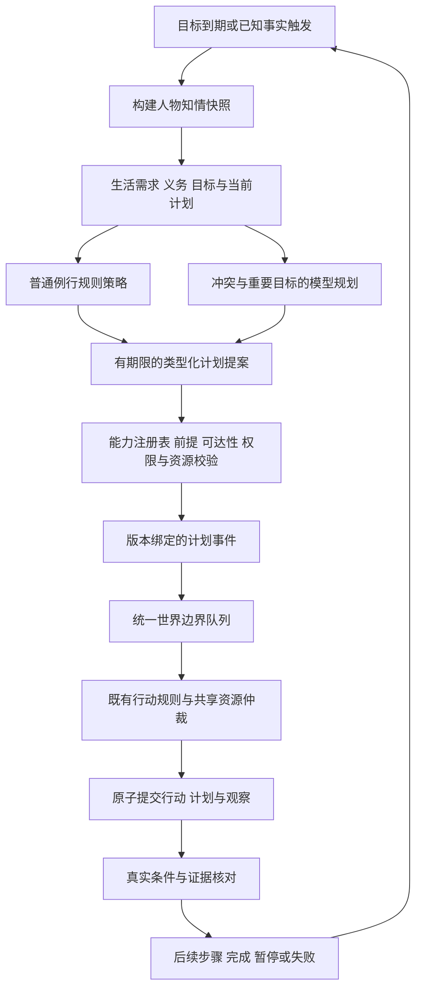

# NPC 自主计划的实现与验收

## 当前证据与缺口

完整城市与封建开局有 273 名人物和 321 个活跃目标。最初的自由试玩发现，这些目标不会自行产生人物行动；仅有生活需求、世界排程、寿终、继任和已有工作安排。此反证保留，不因后续增加计划结构而改写为通过。

2026-11-18 的源码已经接通有限审查排程、人物知情规划、持久计划、能力预检、统一边界执行和租约事务。完整世界的固定策略集成测试已观察到正式出发、旅程结算及计划完成，并通过创世回放和隔离归档恢复。这是规则与事务证据，不能代替真实模型自主玩法验收。真实 Ollama 首次请求因动态输出 schema 的嵌套引用缺失而返回 HTTP 400；未产生计划或行动，失败原档保留，修复后使用独立测试。

现有执行链支持瞬时动作和旅程。巡查、交易、生产和训练可按各自的世界规则开关共享时钟，并在结束边界核对实际结算。失败后可按已有有限排程复审。默认内容尚未普遍启用目标审查，事件驱动唤醒、跨计划的目标复核、机构协作及长期成本控制仍待完成。正式网页部署维持已有验收版本。现有 600 年作业继续按各自固定内容和规则版本执行。

## 运行链路

人物规划输入复用 `build_agent_knowledge`，再补充其自身需求、库存、能力及明确可观察的公共服务。不得将全世界目标、秘密、作者描述或 GM 查询记录传给人物。机构规划必须通过仍有授权的代表或制度渠道；成员资格不等于代表权。

动作能力由注册表提供结构化参数、前提检查、开始和完成边界、资源占用、取消与失败结果。计划只引用这些能力，不允许模型直接写事件、任意修改组件或自行定义能力。探索、迁移、学习、生产、社交、调查、战斗与政治共用计划生命周期，通过各自能力适配器执行，不能把所有目标退化成出勤或等待。

## 持久状态与一致性

- 人物计划记录所有者、目标引用、修订、状态、步骤、当前步骤、下一次检查时间、尝试次数、失败理由和证据。计划与行动均可从事件回放，不只保存在工作器内存或提示词中。
- 步骤使用能力标识和受限参数，持久化时检查实体引用、参数大小和已登记能力。执行前再次检查当前状态、资源、控制权与权限；规划成功不代表执行必定成功。
- 共享世界只推进一次时间。多个 NPC 的长行动登记开始、完成和中断边界，不逐人调用会重复增加全世界时钟的玩家长行动。有限资源按规则次序或明确竞争规则仲裁，不按模型回复快慢分配。
- 同一边界先结算到达、死亡和环境变化，再规划与仲裁。死亡、失能、角色被账号接管、路线关闭、资源不足、拒绝及新消息均能取消或重排相关步骤。已由账号控制的人物不得由后台代做决定。
- 失败须记录并退避，允许换办法、暂停或放弃；重开进程、重发请求或重放存档不得重新抽取失败结果。目标没有可执行办法时留下明确阻塞，不能用进度数字冒充行动。
- 目标完成必须满足已登记条件并引用实际提交事件；纯叙述目标在条件尚未明确时只能记录进展或请求规划，不能自行宣布成功。

## 长时间调度

按人物相关性、义务边界和影响程度安排审查周期。普通生活采用可审计的规则聚合，重大冲突才调用模型；远方债务和约定仍在准确到期边界唤醒。每次聚合写明覆盖区间、实际计算和未展开细节。质量档位改变规划与反思深度，不得改变守恒、寿终、知情隔离和权限检查。

自主计划通过显式版本或作者预览后的新分支启用。既有长期作业不自动升级，任何旧档补排程均需记录起始时间、覆盖范围及采用的新策略，不能追认从未发生过的过去行动。

当前源码的人物编辑页支持世界拥有者为有活跃目标的新人物和已有 NPC 安排有限复审。提交时间不前进，首次排程位于一个世界日后。账户受控角色不能加入。排程接入既有租约决策边界，计划仍由模型和世界规则各自验证。已在 API 回归中确认预览、作者提交与租约的衔接。当前已有排程须在该批完成后才可重新登记。

## 必须取得的证据

1. 完整生成世界中，玩家不介入，至少两名人物因不同目标产生可核查的实际行动，地点、资源或关系发生有来源的变化；旁观者知识仍受隔离。
2. 从同一开局改变一条真实条件，计划或执行结果相应变化；保持原条件的对照分支不应无故改变。
3. 拒绝、断供、受伤、迁移和死亡中的至少三类干扰，能造成重排、取消或合理放弃，并继续下一幕。
4. 至少覆盖探索、关系社交、经营与政治四类适配器；魔法或修仙能力另验证时间、材料、权限与失败代价。
5. 并发竞争、存档恢复、幂等重试、控制权变化与长时间聚合有实际事务和回放证据。长期容量审计另行进行，不用局部自主行动通过替代 600 年验收。

成熟度结论同时依赖这些行为证据与开放试玩，不以计划记录数量或模型调用数作为自主性通过标准。

## 真实规划对照定位的执行缺口

2026-11-19 的完整现代城市中，两名未受账号控制的成年人物分别因疏散准备和燃料储备目标接受审查，开局保留 24 个政体、24 个其他组织、120 处地点与 273 名人物。两次 DeepSeek Flash 调用都形成了提交前持久保存的计划。两名人物均自主选择先巡查，其中一人随后计划交易。两份计划都停在第一步，世界仍正常推进至第 3600 秒。记录只有计划、审查与阻塞事件，以及时间和背景生活结算。该回合尚无人物巡查或交易产生的世界事实。

现有玩家 `explore` 将 600 秒占用、需求消耗、寿命检查、发现与记忆放在一个命令中。NPC 所需的共享时钟接入必须拆开这些责任。第一项区间适配选择了巡查，因为两次独立模型决定都实际依赖它。下列契约仍需实现和端到端验证。

1. 开始时核对人物、地点、可行动状态和时间占用。提交带开始命令、人物、地点、计划步骤、开始时间和到期时间的区间记录。保留本次确定性检定的标识，使进程恢复与分支重放得到同一结果。开始提交不调用世界时钟、不发现对象。
2. 同一世界窗口可包含多名人物的区间。世界时钟与耗时需求只按真实经过时间结算一次。巡查者不能同时进入另一个需占用时间的活动。死亡、地点变化和账号接管应作为区间终止的明确依据，并按同一时间边界的既有优先顺序结算。
3. 到期时重新核对现场状态，再调用与玩家巡查共享的规则判断结果。发现只给实际搜索者，落空也要写有来源的尝试收据。已有对象移动、受伤、地点关闭与死亡等情况不能产生幽灵发现。失败收据与实际发现收据分别决定计划下一步，不能只凭计划文字号称成功。
4. 按实际租约验证起止事件、占用和收据。用完整世界复测两人重叠巡查、单方中断、共享时钟、仅相关角色获知，及恢复后正好结算一次。分别检查有发现和落空两种路径。后续将同一机制扩到训练、交易与生产，其中交易和生产须另外设计资源扣留、释放及原子交割。

玩家巡查已经将只读结果计算提取为共享规则方法。即时玩家入口仍负责原有 600 秒、需求、寿终和事件顺序。规则回归用同一确定性命令比较玩家结果与到期状态的巡查结果，并验证目标在到期前已退役时没有发现和记忆事件。

`npc_shared_exploration_v1` 是测试世界明确登记的新规则开关。启用后，正式租约在计划修订中保存巡查位置、原命令和起止时点。开始事件没有发现副作用。时间推进在最早到期边界停住，巡查者的日程休息暂时停用，需求仍按共用时间窗口结算。到期时重读现场，复用起始命令的检定种子，并将发现、无目标、检定落空或中断写入对应的计划修订。发现和无目标都能结清一次已执行的巡查；检定落空保留等待重试的结果。过往未启用该规则的世界使用原历史路径。

新版完整城市对照中，Sam Diaz 自行选择两次巡查后向同场人物说话。两次巡查在第 600 秒与第 1200 秒真实结算，均未找到东西。后续定向言论产生两条人物记忆，计划在第 1200 秒完成。Abena Evans 自行选择先买燃料，因交易区间未实现保持阻塞。现有 300 秒玩家交易把查价、可售库存、现金、FIFO 库存批次和双边交割放在一个操作中。后台执行要在开始记录允许的数量、卖方和价格，到期重新核对当前报价、出席和账户。共同竞争同一批库存时须按确定的提交次序原子结算，无法按原条件成交时留下具体失败依据；不能沿用开始时算好的库存或扩大购买预算。证据 `.runtime/evidence/probe-npc-shared-search-deepseek-20261119.json`。

后续已在启用 `npc_shared_trade_v1` 的世界落实上述交易契约。开始先记录约定单价及其卖方、品类和库位，到期重新生成同一玩家规则使用的原子交割。交易不预先扣款或保留库存，因此多人同价购买的开始顺序可以重叠，到期由已记录的计划顺序解决竞争。两人购买一单位仅余库存时，一人成交，另一人获得缺货收据并保留余额。反事实涨价验证将触发报价变化收据。旧世界保持原计划阻塞历史。

人物复审时会看到与当前目标有关的近期受阻步骤。规划输入取最近七个世界日内最多四条本人仍受阻的记录，提供动作种类、目标、时点和预定义结果描述。它省去旧计划完整参数、原始诊断文本和他人受阻记录。旧报价失败只代表当时条件，重新报价及改走其他办法都要经过正常预检。已有有限复审排程可在边界替换旧计划，旧失败事件仍留在历史中。

启用 `npc_failure_review_v1` 后，正式租约把受阻收据和后续复审写入同一次计划修订。该规则只重启本人已结束的既有复审，沿用排程 ID 与已运行次数。第一次可在原规则的重试时点复审，后续间隔至少为一个世界小时（同时至少 120 秒），总运行次数触及 13 后停止自动追加。已有待执行排程优先。没有到复审时仍有效的关联目标、人物退役或变成玩家时，不追加复审。规则默认关闭，初次复审的配置仍需外部提供。

固定策略回归在同一租约让两名人物竞争最后一份库存，开场每人仅有一次复审。成交者没有额外复审；缺货者第 300 秒受阻，第 420 秒收到自己的失败摘要并改为巡查。旧计划以取消状态保留，新计划在第 1020 秒完成尝试。创世重放及两种归档恢复与提交后的世界状态一致。此场验证了规则，决策使用固定策略。

训练现在可通过 `npc_shared_training_v1` 在共享时钟执行。开始记录本人已有技能和时段，没有技能或经验收益。到期时以当时能力状态使用玩家训练的同一成长公式，写技能、角色成长与训练收据。账号接管会终止未完成训练。固定策略测试同一窗口两名角色各练习 600 秒，各得 2 经验，世界时钟经过 600 秒；在占用状态导出恢复后接管一人时，只为仍托管的另一人结算。旧世界无启用标志时沿原处理流程。

完整修仙种子 4 中，已有寻找安全训练场目标的 Ling Wu 由 DeepSeek Flash 自行选择先交谈、再练习修炼技能四小时，另一名 NPC 选择巡查。原实测进程在到期时因源码热加载混用两个方法签名失败。保留失败作业和原有模型选择，从已提交的 14400 秒检查点分叉，由固定源码版本结算原训练，技能实得 48 经验，并自然推进到 28800 秒。恢复支线没有重新调用模型。创世重放核对通过。证据 `.runtime/evidence/probe-cultivation-npc-shared-training-20261119-recovered.json`。

启用 `npc_shared_production_v1` 可在共享时钟内使用可见工坊的登记配方。开始只锁定此次约定的配方及人物占用，生产方的库存和额度不预扣，也不独占工坊。到期重新计算实际可用的原料、批次与额度，地点或配方变化会阻止交割。两个工人同时开工、只够一份原料的租约回归中，世界经过 600 秒，第一单原子消费 2 木材、产出 1 工具，第二单因缺料失败。进行中归档恢复后，按同一顺序重新得到相同的库存与两份收据。计划保留成功转换事件与收据，无需递归引用所有库存及编修事件。

### 计划收尾时核对实际目标

启用 `npc_goal_completion_v1` 后，最后一个步骤提交的实际动作若使该角色的某项已登记目标由未达标变为达标，计划修订一并保存完成的目标和本次行动证据。旅程结算在独立的时间边界发生，收尾时使用已校验的本人实际抵达收据及目的地。同步检查作者登记的全部条件和截止时点，只有叙述的目标继续保持原状态。旧计划修订省略新增字段，原始保存过程及回放口径保持历史语义。

当前条件判断限于本人地点、库存、状态、由本人指向的可读关系以及本人已完成的前置目标。须有实际行动使条件达标或抵达收据证明到达。该规则由显式世界设置启用，未用于现有长跑或正式实例。

对照原 DeepSeek Flash 调价实玩的第 31 条提交，复用 Aiko Evans 已选定并执行的两份燃料采购，从相同账本结算。原先目标为库存 20，实际从 13 到 15，计划收尾后目标依然活跃。仅在分离的内存状态把目标门槛设为 15，同笔交换才把目标标为达成，并保存账本和计划修订两份事件。原世界与创世摘要一致，没有再次调用模型。证据 `.runtime/evidence/npc-goal-completion-market-counterfactual-20261119.json`。

启用 `npc_goal_completion_each_step_v1` 的世界在每次实际消耗计划步骤时就核对关联目标。一旦达标，保存该步事件证据和达标时刻。后续步骤仍按原定规则执行和留下各自收据，已达成目标的旧截止时间不再截断这份既有计划。用于新计划的目标依然必须活跃。仅启用收尾规则的老世界仍按原条件检查时点回放。跨多份计划以及其他人引发的目标条件变化仍待接入。

从既有 DeepSeek Flash 试玩的第 8 条提交重新执行 Abena Evans 原本选择的采购和巡查。第 300 秒买入两份燃料，储备从 3 增至 5，原定 20 份的目标在第 900 秒巡查结算后仍活跃。内存对照仅把目标门槛设为 5，目标在第 300 秒由采购和计划修订收据完成。巡查仍在第 900 秒按原计划结束，目标时点和证据不变。两路账本和知识与原存档一致，原档未写入，也未再次请求模型。证据 `.runtime/evidence/npc-step-goal-completion-real-plan-20261119.json`。

### 同一计划内的前置目标

世界加载会检查完整的目标清单，因此前置目标在存档中排在依赖项之前或之后都可引用。原清单顺序及其摘要不变，重复目标与缺失引用仍受校验。

对已启用逐步目标核对的世界，可另外显式启用 `npc_goal_dependency_completion_v1`。实际动作先达成已登记条件，再传递到同一 NPC 在同一计划中引用的依赖目标。每一级依赖仍需满足自己的全部条件和截止时间。所有达标目标与原行动凭证一起写入该步修订，已达标的前置项不靠后续巡查补证。没有可证明成立的起点时，循环依赖无法自行达标。原有存档未开启规则时继续按原路径回放。

用 Abena Evans 已实际执行的采购与巡查做隔离对照。在分离状态将储备门槛设为 5，补入三项目标，故意将依赖项排在其前置项之前。第 300 秒采购使储备目标和两级依赖目标一起达成，另一项仍需 20 份燃料，继续保持活跃。第 900 秒巡查按原计划完成，无新的目标达成事件。对照的账本与知识和原档一致，原档摘要不变。SQLite 专项核对同批提交、创世回放和两种归档恢复。证据 `.runtime/evidence/npc-goal-dependency-real-plan-comparison-20261119.json`。

### 下一份计划读取已达成的前置目标

NPC 复审资料会为可见的本人 `goal_completed` 条件补充前置目标的当前状态和更新时间。已经达成的目标保留为后续行动的依据，从模型可选目标列表移除。跨人物引用不进入该人的知识或计划范围，临时说法不替代已提交目标。

启用 `npc_goal_followup_review_v1` 且已经登记过复审时，计划完成并留下达标凭证，可为同一人仍有实际工作、前置项齐备的后续目标重新安排一次复审。继续沿用原排程和有限次数，有已排队的复审时不重复安排。真实 DeepSeek Flash 在只登记一次初始复审的世界中于第 60 秒到达驿站，结算事件记下第 180 秒的复审。模型于该时刻提出第二份计划，第 240 秒到达码头。创世回放、2.0 归档及复审事件复核一致。证据 `.runtime/evidence/npc-repeated-review-real-20261119-wake.json` 和对应的 `-restore.json`。

真实 DeepSeek Flash 在三个地点的隔离世界中分两次规划。林穗先从渡口集市抵达河堤驿站，第 60 秒结算前置目标；第二次复审在第 120 秒读到该目标已达成及本地下一段路线，另起一份计划。第 180 秒抵达下游旧码头，后续目标以自己的抵达收据完成。推进至第 240 秒，创世回放和 2.0 归档恢复摘要一致，两张抵达收据分别保留。首轮测试角色缺少旅行权限，真实模型两次均暂缓，保留该档。授予旅行能力的对照在独立世界运行。相关 32 项测试通过。证据 `.runtime/evidence/npc-repeated-review-real-20261119.json`、`.runtime/evidence/npc-repeated-review-real-20261119-travel.json` 与对应的 `-restore.json`。

### 正常建档的多样行动预设

现代 2.8、修仙 2.8 和封建 2.9 的开局数据各有 264 个居民资源储备条件、32 个带人物动机的自由文本目标、48 个机构储备目标和 1 个属于玩家的到达条件。资源储备是三个设定中具名 NPC 都有的可验证目标。旅行可以执行，但现有开局 NPC 的文字动机尚未绑定实际目的地。

正式建档接口已接入显式选用的 `diverse_v1` 预设。现代步道维护员、封建信使和修仙山路信使各从已登记且可合法出发的路线取得独立到达目标。随后依照现有资格规则挑选两位有实际可采购储备目标的居民。第 1、3、7 日各登记一次复审，再由共享规则检查模型选择。默认关闭和原有限采购模式保留原语义。内容专项覆盖三个背景，封建 2.9 的正式接口验证了三次排程、重复建档及同键改变模式的冲突。现代 2.8 已验证普通网页建档与隔离 HTTP 真实玩法。DeepSeek Flash 让步道维护员从第 86400 秒走到第 90000 秒并完成独立到达目标。原有开放道路目标继续活跃。第 259500 秒另一名居民实际完成采购，锚点与分支头回放一致。封建 2.9 和修仙 2.8 也各由两次真实 DeepSeek Flash 复审验证。信使均实际抵达并完成到达条件，旧人物动机仍活跃。修仙采购买入矿石，封建第 3 日建议的首步当前不可执行，作业正常结束隔离窗口并保留拒绝。三个对照的锚点与分支头均匹配。联合证据见 `.runtime/evidence/npc-diverse-v1-three-packs-real-20261121.json`。网页证据见 `.runtime/evidence/npc-diverse-ui-acceptance-20261121-a1/evidence.json`，行动证据见 `.runtime/probe-npc-autonomy-diverse-v1-http-deepseek-20261121-modern_city/evidence.json`。

### 已接受约定的自主赴约

正式租约推进到已接受约定的开始时刻时，可为在场且仍由引擎托管的 NPC 发出赴约决策。可拆分的休息、等待、修习及途中阶段允许在边界处理；原子行动保留自己的结算时段。到场只在约定半开区间内判定。普通事件优先结算，因此实际抵达、工作交接、限时计划完成和人物死亡都会影响资格。单纯查询 GM 不触发该决策。

模型只收到这次约定、已核实的同地状态及本人对对方可知的背景，可选择到场或暂不赴约。到场只写本人的记录，暂不赴约只写一条作者可见的内部决定，二者都不推进世界时钟。每个已接受邀请对同一托管人物只自动询问一次。暂缓后仍可按现有规则明确赴约。提交在当前世界版本及作业租约下复核条件，已固定的答复可由新租约接续。真实模型样本与受控恢复测试分别记录在验收矩阵。

## NPC 主动履约与分期入场

- NPC 计划上下文现在优先装入本人尚可履行的承诺，按截止时间排序。归还预检检查真实库存批次及可见的交付对象，只把可交付库存、当场交付条件和距期限的时间放进承诺人的视角。预检不推断受诺人在视野外的位置，也不会写入世界状态。
- 该预检用于计划输入。期限内自动调度和正式交付仍须接入。在既有 NPC 计划链中，新增归还能力还须让写入、回放和备份验证使用实际行动 NPC 的身份与重算出的规则命令。若同一提交还派生剧情回执，按已登记剧情条件独立验证回执。
- 分期入场需要在引擎中区分尚未入场与已存在但当前不可见的人物，并统一对话、地图、知情引用、调度和剧情的可用范围。100 多名东方原作角色逐个重建并提供互动仍是未交付项。通用角色能力的规模测试不能代替原作角色的内容验收。

### 归还承诺接入复审与交付

- 启用 `npc_return_commitment_reviews_v1` 的世界里，新登记的非主角归还承诺会产生本人可见的目标，并把常规 NPC 复审提前至期限内。首次专用排程最多复审三次，最后一次可以落在截止时点。其他账号控制的人物由正式宿主跳过，现有未启用世界的排程保持原样。
- NPC 可以选 `fulfill_return_promise`，只引用本人有效的归还承诺。宿主提交前复核控制权、受诺人可见性、在场、时间和库存批次。真正交付后才完成目标并记录凭证。明确解除或到期后仍未归还会分别关闭目标，信任与剧情沿已有规则结算。
- 测试覆盖提前履约、两次暂缓后在截止时点履约、玩家控制权排除、独立分支，以及提交中同时产生剧情回执的即时归还。备份验证重算 NPC 的实际命令。真实 DeepSeek Flash 在第 2 秒选择并归还一份草药，期限是第 60 秒。库存从 5 到 4，对方从 0 到 1。原作业续跑、创世回放及隔离恢复摘要一致。证据 `.runtime/evidence/npc-commitment-live-deepseek-20261123.json`。
- 多种事务接入、不能履约时实际采取的准备动作、明确拒绝与受阻的差异结算、角色分期入场仍待继续实现。

对照另一条实际计划链时，受诺人先走到邻近工房。复审后的 NPC 先按通行规则前往该地点，旅程收据结算后才执行交付。关系变化与剧情出现在抵达后的同一时点，独立恢复一致。此对照使用可信测试策略，真实模型例只验证当场交付。采购备货与协商延迟仍未接入这条履约流程。

### 角色按剧情分期入场

世界包可用 `story_arrivals` 登记角色模板、触发的剧情节点、可选的结果键、入场地点及初始关系和目标。分期条件复用定时节点、前序剧情和状态触发。已经在所选开场前到岗的人物直接进入该开场的初态。尚未到场的人不会进入实体表、在场人物、普通 GM 上下文或可对话目标。

节点提交时，以分支实际结果与地点可用状态确定到场名单。正式回执绑定到场身份，之后按普通具名角色进行对话、移动及关系更新。若地点关闭，该次节点不生成到场身份。已登记的初始关系在双方都实际存在时才生效，并引用使双方到齐的事件。作者还可以给新人配置私有目标和入场后复审时距。实际到场才开始计算复审时点，继续走既有模型提议、行动授权、工作器租约和到账证据。

幻想乡原作资料包 0.6.0 的守矢开场可在妖怪之山遇到分期到岗的原创水尺员。远岬站 1.3.0 同时提供钟点到岗、后期开场已到岗、验收结果触发到岗三个对照。隔离实测中，段禾随电池验收在第 60 秒到场。真实 DeepSeek Flash 完成首次交接对话，产生公开剧情和私有关系证据，时钟保持在第 60 秒。原作人物互动是独立未交付项，资料索引不充当该项验收。

规则集成测试还覆盖段禾以自己入场后的目标登记复审，随后自行从避护区回到接驳台，触发复查剧情。玩家一直留在避护区。另有 120 名原创人物分三批到场的测试，逐人核对了知情视图和在场名单。该规模测试未对 120 人分别调用模型。

真实模型续跑对照同一个远岬站互动存档。首个分支在第 300 秒收到语义复核网络错误，计划没有执行，失败记录保留。在第 60 秒的对话提交处分出新分支后，DeepSeek Flash 完成了计划及复核。段禾从避护区出发，第 360 秒到达接驳台，目标和剧情同时结算，玩家仍在原地。创世回放和备份恢复一致。证据为 `.runtime/evidence/distant-station-130-staged-dialogue-real-20261123.json`、`.runtime/evidence/distant-station-130-staged-autonomy-real-20261123.json` 与 `.runtime/evidence/distant-station-130-staged-autonomy-real-retry-20261123.json`。本轮联合回归 95 项通过。
